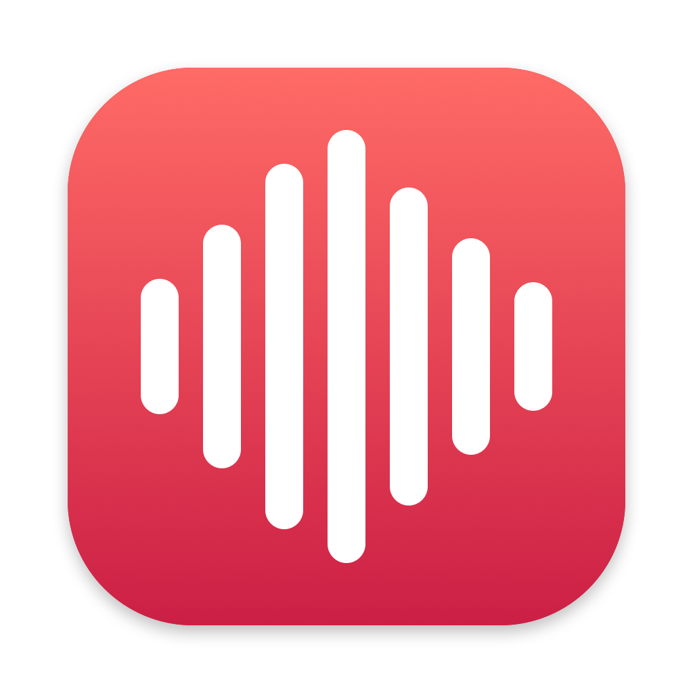
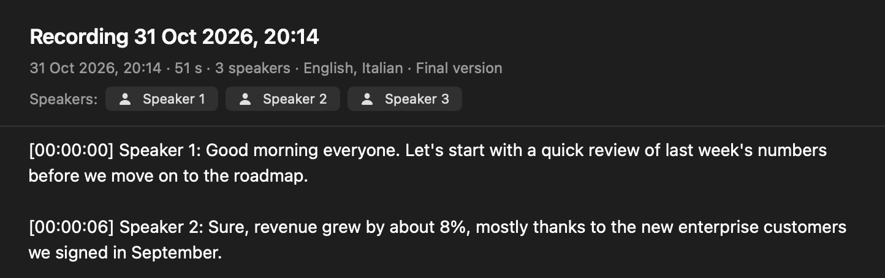
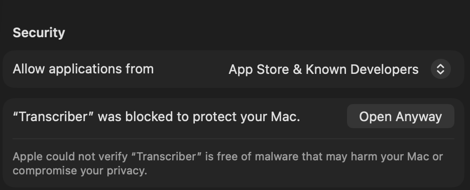

<p align="center"></p>

# Transcriber

A free Mac app that records your lectures and meetings and turns them into text, **entirely on your Mac**. No account, no subscription, no cloud: the audio never leaves your computer.

Proudly made by **Matteo Firinaiu** · [Instagram](https://www.instagram.com/matteo.firinaiu) · [LinkedIn](https://www.linkedin.com/in/matteo-firinaiu/) · [GitHub](https://github.com/matteofirinaiu)



## What it does

- **Live draft while you record.** The text appears as people speak, so you can follow along.
- **Accurate final version when you stop.** A second pass over the whole recording, with a timestamp on every paragraph: `[00:12:34] ...`
- **Who said what.** The final version tells voices apart: `[00:12:34] Speaker 2: ...`. Click a speaker at the top of the transcript to rename them everywhere, for example "Prof. Rossi". Give two speakers the same name to merge them.
- **25 European languages**, detected automatically, even when a lecture switches language halfway. Tested mostly with English and Italian.
- **Plain Markdown files** in `Documents/Transcriber`. Search them in the app, copy everything with one click, or export to `.md` or `.txt`.
- **Safe if something goes wrong.** If the app quits during a recording, it offers to recover it at the next launch. The audio is deleted only after the transcript is saved.

## Download and install

You need a Mac with Apple silicon (M1 or newer) and macOS 26 Tahoe or newer.

1. **[Download Transcriber.dmg](https://github.com/matteofirinaiu/transcriber/releases/latest/download/Transcriber.dmg)** (about 13 MB).
2. Open it and drag **Transcriber** onto the **Applications** folder.
3. Open Transcriber from Applications. If it opens, you're done. More likely, the first time macOS blocks it because the app isn't signed with a paid Apple developer account: click **Done**, not "Move to Trash".
4. Open **System Settings → Privacy & Security** and scroll down to the **Security** section. Next to "“Transcriber” was blocked to protect your Mac." click **Open Anyway**, then confirm with your password or Touch ID. The button only appears after you've tried to open the app once.

   

5. If Transcriber doesn't open by itself, open it again from Applications.

You only do this once per version. If macOS says the app "is damaged and can't be opened", run this in Terminal and open the app again:

```bash
xattr -dr com.apple.quarantine /Applications/Transcriber.app
```

### First launch

- Transcriber downloads its speech models once, about 640 MB from Hugging Face. Use Wi-Fi; after that everything works offline.
- The first time you record, macOS asks for the **microphone**: click Allow.
- When the first transcript is saved, macOS asks for the **Documents** folder: click Allow.

### Updating

Download the new `Transcriber.dmg` from the same link and replace the app in Applications. You'll have to click Open Anyway and allow the microphone again. Your transcripts stay where they are.

## Tips for lectures

- Sit near whoever is speaking. The built-in microphone works, but distance and noise lower the accuracy.
- **Keep the lid open** while recording: a closed MacBook goes to sleep and the recording stops.
- Plug in the charger for long lectures.
- If you know how many people will speak, pick the number under **Speakers** before recording.
- **Ask before you record**, and follow your university's rules about recording lectures.

## How well it works

Measured on a MacBook Air M4:

- **Speed:** a 2-hour lecture becomes a transcript with speakers in about a minute and a half.
- **Memory:** about 1 GB at most, while the final version is being created.
- **Accuracy** on synthetic test audio, with English and Italian mixed: 0.6% to 1.6% of the words wrong in the final version, about 2% in the Automatic live draft.
- **Speakers:** in a test conversation with three voices, all 8 turns went to the right person, even with pauses of 0.3 seconds. On real meetings recorded with a single microphone (the AMI benchmark), the model mixes up who is speaking about 11% of the time.

## Live draft modes

The picker above the record button has three modes, and you can switch during a recording:

- **Automatic** (default): the voice detector cuts the audio at pauses and Parakeet transcribes each sentence, detecting its language. The draft updates every 1–2 seconds.
- **English** or **Italian**: the speech recognition built into macOS, word by word, in one language.

The final version always detects the language by itself.

## Privacy

Recording, transcription and speaker separation all run on your Mac's Neural Engine. The app goes online only to download the models the first time. No accounts, no analytics.

## Where your files are

| What | Where |
|---|---|
| Transcripts | `~/Documents/Transcriber/` (you can change it in Settings) |
| Temporary audio | `~/Library/Application Support/Transcriber/Recordings/` |
| Speech models | `~/Library/Application Support/FluidAudio/Models/` |

Each transcript is a Markdown file:

```markdown
---
title: "Recording 31 Oct 2026, 10:00"
date: 2026-10-31T10:00:00+01:00
duration: 01:28:40
languages: en
speakers: Prof. Rossi, Speaker 2
version: final
id: D9DF21CE-2F4E-4F0A-A800-0C0CB0D5D054
---

# Recording 31 Oct 2026, 10:00

[00:00:04] Prof. Rossi: Good morning, today we start with...

[00:12:30] Speaker 2: Could you repeat the last formula?
```

## Limits

- With a single microphone, speaker separation sometimes gets it wrong: similar voices, people talking over each other, one-word answers. The audio isn't kept, so you fix a wrong speaker by renaming.
- Microphone only: no system audio from Zoom, Meet or Teams, and no importing audio files, for now.
- In Automatic mode the live draft appears sentence by sentence instead of word by word.
- No automatic updates: get new versions from the same download link.

## Build from source

You need Apple's Command Line Tools (`xcode-select --install`). Xcode isn't needed.

```bash
./scripts/build_app.sh
```

```bash
open build/Transcriber.app
```

Run the tests:

```bash
./scripts/test.sh
```

Create the disk image to publish (`dist/Transcriber.dmg`):

```bash
./scripts/package.sh
```

Test commands that run without a microphone. `--words` prints every word with its time and speaker, `--segments` prints the pieces the draft cuts the audio into:

```bash
build/Transcriber.app/Contents/MacOS/Transcriber --final lecture.wav --speakers 3
```

```bash
build/Transcriber.app/Contents/MacOS/Transcriber --live lecture.wav auto
```

```bash
build/Transcriber.app/Contents/MacOS/Transcriber --assets --download
```

There's also an automated test of the whole app. It plays an audio file instead of the microphone and saves the transcripts in a separate folder. Don't run it while you're recording with the app, because it opens a second copy:

```bash
open -W -n build/Transcriber.app --args --autotest 80 --inject lecture.wav --library /tmp/test --report /tmp/test/report.json
```

## Project structure

```
Sources/TranscriberCore/   pure, tested logic: Markdown format, paragraphs and times, speakers, crash-safe WAV, library
Sources/Transcriber/       the app: Audio/ (microphone), Live/ (live draft), Parakeet/ (models and final version), UI/ (SwiftUI)
Tests/TranscriberTests/    tests of the logic (Swift Testing)
scripts/                   build_app.sh, package.sh, test.sh, make_icon.sh
Resources/                 Info.plist, entitlements, icon, credits
```

## Credits

Transcriber is made by Matteo Firinaiu and is free and open source under the [MIT License](LICENSE). It's built on:

- [FluidAudio](https://github.com/FluidInference/FluidAudio) by FluidInference (Apache 2.0), which runs the models on the Neural Engine.
- [Parakeet Ultra](https://huggingface.co/FluidInference/parakeet-ultra-coreml) (CC BY 4.0), based on NVIDIA Parakeet TDT 0.6B v3.
- [Silero VAD](https://huggingface.co/FluidInference/silero-vad-coreml) (MIT), the voice detector.
- The [pyannote "community-1"](https://huggingface.co/FluidInference/speaker-diarization-coreml) speaker models (CC BY 4.0).
- Apple's Speech framework, for the English and Italian live drafts.

Details in [THIRD_PARTY_NOTICES.md](THIRD_PARTY_NOTICES.md). The architecture was inspired by [pasrom/meeting-transcriber](https://github.com/pasrom/meeting-transcriber) (MIT).
